# Запуск
# Часть 1 Динамическая маршрутизация на основании показателей утилизации памяти
Предполагается, что minikube уже запущен
1. Активировать metrics-server
```shell
minikube addons enable metrics-server
```
Потом надо подождать 1-2 минуты, пока metrics-server начнёт отдавать метрики
2. Применить файл
```shell
kubectl apply -f deployment.yaml
```
3. Проверить приложение
Из Task2
```shell
kubectl port-forward deployment/scaletestapp-deployment 8080:8080
```
4. Проверить оба ресурса из задания
Идентификатор пода:
```shell
curl localhost:8080/
```
Должен получиться примерно такой ответ:
```shell
Идентификатор пода: scaletestapp-deployment-685c9bb848-6cnbb
```
Метрики в формате Prometheus:
```shell
curl localhost:8080/metrics
```
Вернётся примерно это:
```shell
# HELP go_gc_duration_seconds A summary of the pause duration of garbage collection cycles.
# TYPE go_gc_duration_seconds summary
go_gc_duration_seconds{quantile="0"} 0
...
# HELP http_requests_total No of request handled
# TYPE http_requests_total counter
http_requests_total 2
# HELP process_cpu_seconds_total Total user and system CPU time spent in seconds.
# TYPE process_cpu_seconds_total counter
process_cpu_seconds_total 0.04
...
# HELP process_virtual_memory_bytes Virtual memory size in bytes.
# TYPE process_virtual_memory_bytes gauge
process_virtual_memory_bytes 1.261006848e+09
# HELP process_virtual_memory_max_bytes Maximum amount of virtual memory available in bytes.
# TYPE process_virtual_memory_max_bytes gauge
process_virtual_memory_max_bytes 1.8446744073709552e+19
# HELP promhttp_metric_handler_requests_in_flight Current number of scrapes being served.
# TYPE promhttp_metric_handler_requests_in_flight gauge
promhttp_metric_handler_requests_in_flight 1
# HELP promhttp_metric_handler_requests_total Total number of scrapes by HTTP status code.
# TYPE promhttp_metric_handler_requests_total counter
promhttp_metric_handler_requests_total{code="200"} 0
promhttp_metric_handler_requests_total{code="500"} 0
promhttp_metric_handler_requests_total{code="503"} 0
```
5. Применить манифест
```shell
kubectl apply -f service.yaml
```
Проверить можно так:
```shell
kubectl get svc
```
В ответе должно быть что-то вроде этого: `scaletestapp-service   ClusterIP   10.105.238.191   <none>        80/TCP    9s`.
```shell
kubectl get endpoints
```
В ответе должно быть что-то вроде этого: `scaletestapp-service   10.244.0.4:8080     41s`.
6. Применить hpa-memory.yaml
```shell
kubectl apply -f hpa-memory.yaml
```
Проверить можно командой:
```shell
kubectl get hpa
```
В ответе должно быть что-то вроде этого: `scaletestapp-hpa   Deployment/scaletestapp-deployment   memory: 7%/80%   1         10        1          2s`.
7. Запустить locust
Перейти в директорию `locust`:
```shell
cd ./locust
```
Запустить:
```shell
locust
```
Запустится сервер:
```shell
[2026-10-23 23:34:06,990] Eye/INFO/locust.main: Starting Locust 2.47.0
[2026-10-23 23:34:06,992] Eye/INFO/locust.main: Starting web interface at http://localhost:8089, press enter to open your default browser.
```
Перейти в браузере по ссылке http://localhost:8089/
Откроется стартовая страница locust
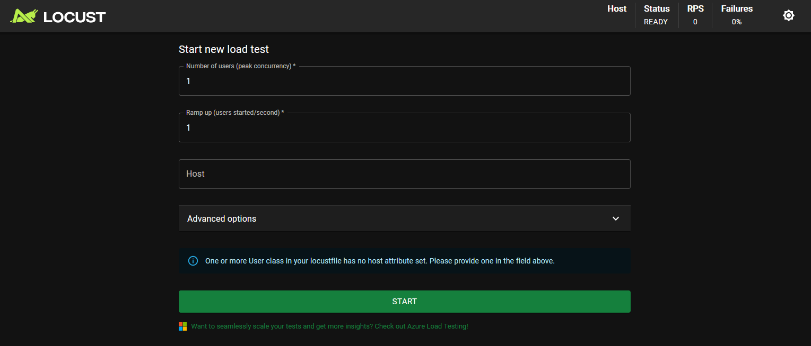
Убедиться, что порты прокинуты
```shell
kubectl port-forward deployment/scaletestapp-deployment 8080:8080
Forwarding from 127.0.0.1:8080 -> 8080
Forwarding from [::1]:8080 -> 8080
```

Можно вызывать так:
```shell
kubectl port-forward service/scaletestapp-service 8080:80
```
> [!TIP]
> `kubectl port-forward deployment/scaletestapp-deployment 8080:8080` свалится после того, как POD упадёт.

8. Запустить тест
Задать Host как http://127.0.0.1:8080Ye;tyj
Number of users: 800
Ramp up: 20

Начинать можно с 200 пользователей и Ramp up 10, но если за 5 минут утилизация не достигает 80%, то эти показатели лучше повысить.

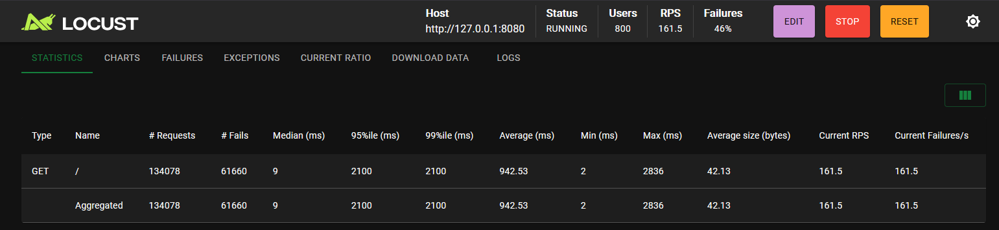
Тест с 800 пользователями (ramp up 20). Ошибки сосредоточены в моменты OOMKill пода и обрывов port-forward; медианное время ответа 9 мс — сервис в целом здоров.

---
Потом можно открыть дашборд minikube
```shell
minikube dashboard
```
Стартовая страница
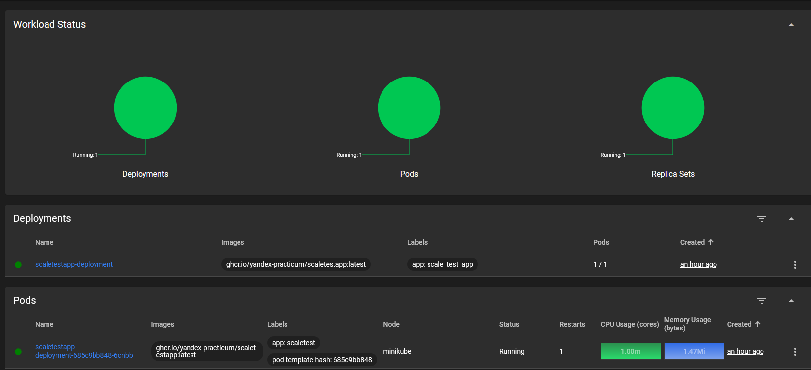

Deployment
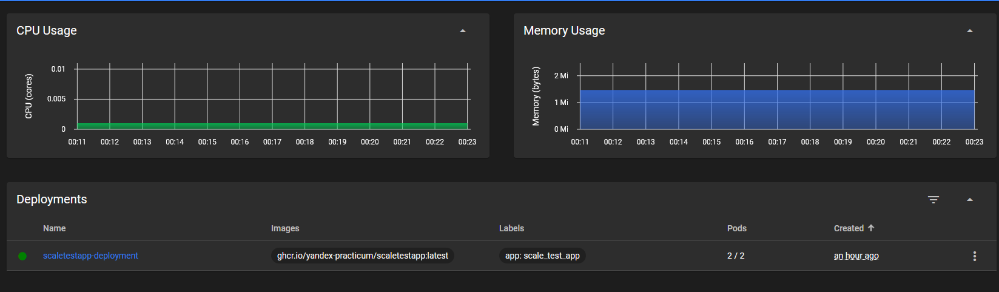

Вот запрос get-pods
```shell
kubectl get pods -w
NAME                                       READY   STATUS    RESTARTS      AGE
scaletestapp-deployment-685c9bb848-6cnbb   1/1     Running   1 (19m ago)   85m
scaletestapp-deployment-685c9bb848-2zv2g   0/1     Pending   0             0s
scaletestapp-deployment-685c9bb848-2zv2g   0/1     Pending   0             0s
scaletestapp-deployment-685c9bb848-2zv2g   0/1     ContainerCreating   0             0s
scaletestapp-deployment-685c9bb848-2zv2g   0/1     ContainerCreating   0             1s
scaletestapp-deployment-685c9bb848-2zv2g   1/1     Running             0             2s
scaletestapp-deployment-685c9bb848-6cnbb   0/1     OOMKilled           1 (24m ago)   90m
scaletestapp-deployment-685c9bb848-6cnbb   1/1     Running             2 (2s ago)    90m
```

Вот запрос get-hpa
```shell
kubectl get hpa -w
NAME               REFERENCE                            TARGETS           MINPODS   MAXPODS   REPLICAS   AGE
scaletestapp-hpa   Deployment/scaletestapp-deployment   memory: 33%/80%   1         10        1          57m
scaletestapp-hpa   Deployment/scaletestapp-deployment   memory: 97%/80%   1         10        1          58m
scaletestapp-hpa   Deployment/scaletestapp-deployment   memory: 97%/80%   1         10        2          58m
scaletestapp-hpa   Deployment/scaletestapp-deployment   memory: 52%/80%   1         10        2          59m
scaletestapp-hpa   Deployment/scaletestapp-deployment   memory: 52%/80%   1         10        2          60m
scaletestapp-hpa   Deployment/scaletestapp-deployment   memory: 52%/80%   1         10        2          61m
scaletestapp-hpa   Deployment/scaletestapp-deployment   memory: 5%/80%    1         10        2          62m
```
Судя по тестам, HPA имеет встроенный допуск ±10% от целевого значения, поэтому реальные пороги срабатывания не ровно 80%, а:
- 88% (scale-up)
- 72% (scale-down)

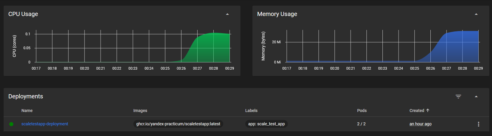

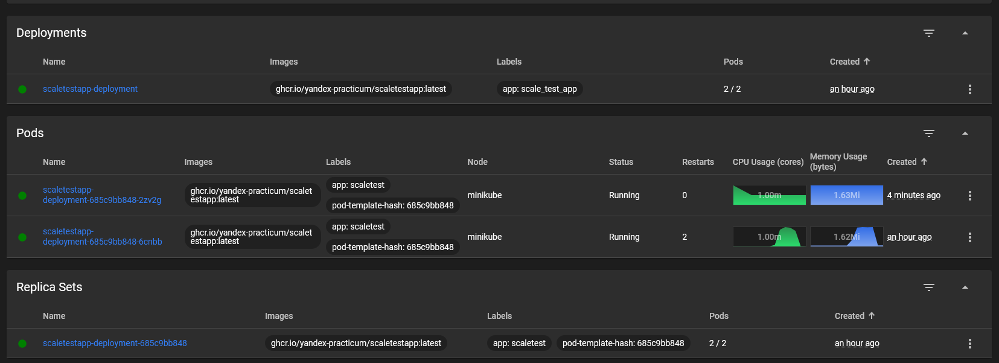

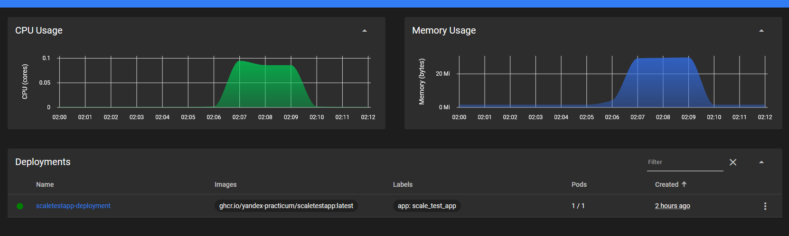


## Часть 2 Динамическая маршрутизация на основании показателей количества запросов в секунду
1. Установить Prometheus
```shell
helm repo add prometheus-community https://prometheus-community.github.io/helm-charts
```
```shell
helm install prometheus prometheus-community/kube-prometheus-stack
```
```shell
kubectl port-forward svc/prometheus-kube-prometheus-prometheus 9090:9090
```
Проверить можно, открыв http://127.0.0.1:9090
Там будет стартовая страница prometheus
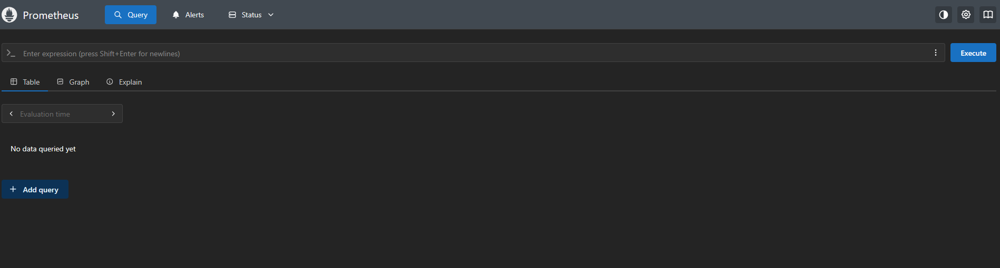

2. Настроить экспорт метрик
Так как был изменён service.yaml, надо его заново применить. Если service.yaml не изменился, этот шаг можно пропустить.
```shell
kubectl apply -f service.yaml
```
Применить servicemonitor
```shell
kubectl apply -f servicemonitor.yaml
```
Тут необходимо убедиться, что появился нужный таргет.
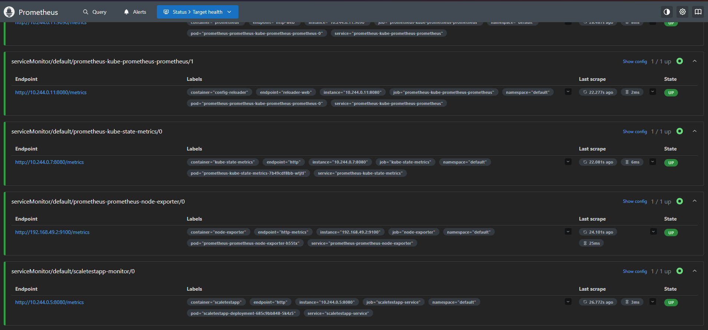

3. Настроить автоматическое масштабирование по RPS через HPA
Установить адаптер:
```shell
helm install prometheus-adapter prometheus-community/prometheus-adapter -f adapter-values.yaml
```
Проверить, что метрика появилась (возможно, потребуется подождать 1-2 минуты):
```shell
kubectl get --raw "/apis/custom.metrics.k8s.io/v1beta1/namespaces/default/pods/*/http_requests_per_second"
```
Ответ примерно такой:
```json
{"kind":"MetricValueList","apiVersion":"custom.metrics.k8s.io/v1beta1","metadata":{},"items":[{"describedObject":{"kind":"Pod","namespace":"default","name":"scaletestapp-deployment-685c9bb848-5k4z5","apiVersion":"/v1"},"metricName":"http_requests_per_second","timestamp":"2026-10-24T10:36:00Z","value":"9m","selector":null}]}
```

Настройки HPA были изменены, поэтому сначала нужно удалить hpa:
```shell
kubectl delete hpa scaletestapp-hpa
```

Применить новые:
```shell
kubectl apply -f hpa-rps.yaml
```
Должно примениться, и `kubectl get hpa` должен показывать что-то вроде этого:
```shell
NAME                   REFERENCE                            TARGETS   MINPODS   MAXPODS   REPLICAS   AGE
scaletestapp-hpa-rps   Deployment/scaletestapp-deployment   0/30      1         10        1          35s
```

4. Провести тестирование и убедиться в работоспособности масштабирования

Процесс создания нового POD-а
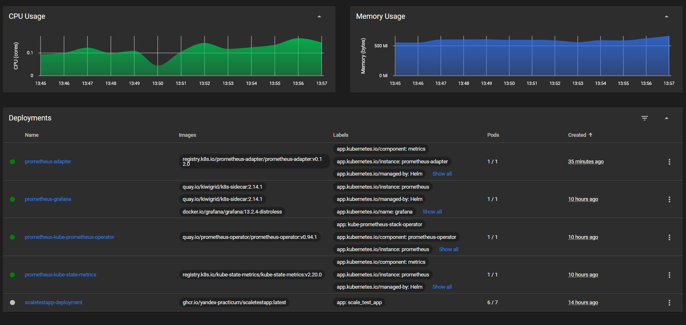

Уменьшение числа POD-ов после снижения нагрузки:
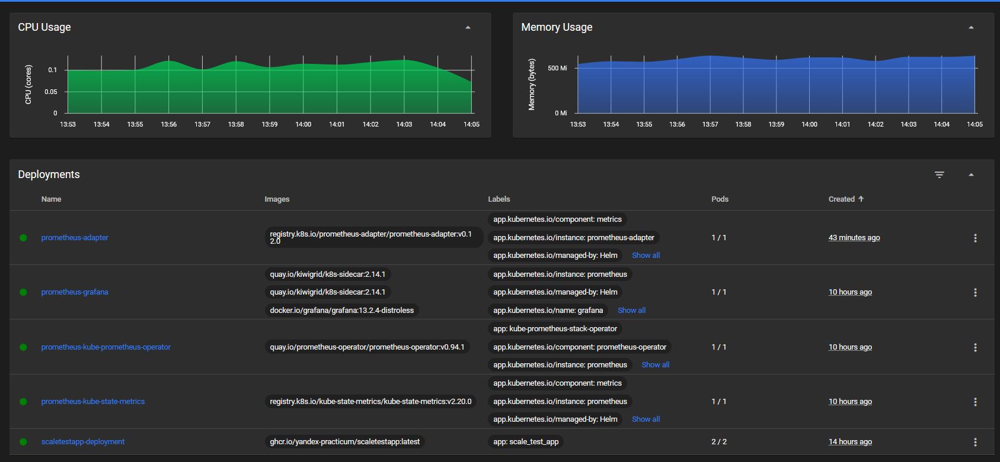

Вот запрос get-pods
```shell
kubectl get pods -w
NAME                                                     READY   STATUS    RESTARTS     AGE
alertmanager-prometheus-kube-prometheus-alertmanager-0   2/2     Running   0            10h
prometheus-adapter-749bdcc4d-t2ckw                       1/1     Running   0            10m
prometheus-grafana-9cc4bb6fc-v99nb                       3/3     Running   2 (9h ago)   10h
prometheus-kube-prometheus-operator-59b4bf45f6-hfd5w     1/1     Running   1 (9h ago)   10h
prometheus-kube-state-metrics-7b49cdf8bb-wtjtl           1/1     Running   1 (9h ago)   10h
prometheus-prometheus-kube-prometheus-prometheus-0       2/2     Running   0            10h
prometheus-prometheus-node-exporter-h55tx                1/1     Running   1 (9h ago)   10h
scaletestapp-deployment-685c9bb848-5k4z5                 1/1     Running   2 (9h ago)   10h
scaletestapp-deployment-685c9bb848-jnjb4                 0/1     Pending   0            0s
scaletestapp-deployment-685c9bb848-jnjb4                 0/1     Pending   0            0s
scaletestapp-deployment-685c9bb848-jnjb4                 0/1     ContainerCreating   0            0s
scaletestapp-deployment-685c9bb848-jnjb4                 0/1     ContainerCreating   0            1s
scaletestapp-deployment-685c9bb848-jnjb4                 1/1     Running             0            2s
scaletestapp-deployment-685c9bb848-wj7sr                 0/1     Pending             0            0s
scaletestapp-deployment-685c9bb848-wj7sr                 0/1     Pending             0            0s
scaletestapp-deployment-685c9bb848-wj7sr                 0/1     ContainerCreating   0            0s
scaletestapp-deployment-685c9bb848-wj7sr                 0/1     ContainerCreating   0            0s
scaletestapp-deployment-685c9bb848-wj7sr                 1/1     Running             0            2s
scaletestapp-deployment-685c9bb848-g8jwp                 0/1     Pending             0            0s
scaletestapp-deployment-685c9bb848-g8jwp                 0/1     Pending             0            0s
scaletestapp-deployment-685c9bb848-g8jwp                 0/1     ContainerCreating   0            0s
scaletestapp-deployment-685c9bb848-g8jwp                 0/1     ContainerCreating   0            1s
scaletestapp-deployment-685c9bb848-g8jwp                 1/1     Running             0            2s
scaletestapp-deployment-685c9bb848-6jl8s                 0/1     Pending             0            0s
scaletestapp-deployment-685c9bb848-6jl8s                 0/1     Pending             0            0s
scaletestapp-deployment-685c9bb848-6jl8s                 0/1     ContainerCreating   0            0s
scaletestapp-deployment-685c9bb848-6jl8s                 0/1     ContainerCreating   0            1s
scaletestapp-deployment-685c9bb848-6jl8s                 1/1     Running             0            5s
scaletestapp-deployment-685c9bb848-rzjqx                 0/1     Pending             0            0s
scaletestapp-deployment-685c9bb848-rzjqx                 0/1     Pending             0            0s
scaletestapp-deployment-685c9bb848-rzjqx                 0/1     ContainerCreating   0            0s
scaletestapp-deployment-685c9bb848-rzjqx                 0/1     ContainerCreating   0            0s
scaletestapp-deployment-685c9bb848-rzjqx                 1/1     Running             0            1s
scaletestapp-deployment-685c9bb848-xzhbj                 0/1     Pending             0            0s
scaletestapp-deployment-685c9bb848-xzhbj                 0/1     Pending             0            0s
scaletestapp-deployment-685c9bb848-xzhbj                 0/1     ContainerCreating   0            0s
scaletestapp-deployment-685c9bb848-xzhbj                 0/1     ContainerCreating   0            1s
scaletestapp-deployment-685c9bb848-xzhbj                 1/1     Running             0            5s
scaletestapp-deployment-685c9bb848-5k4z5                 0/1     OOMKilled           2 (9h ago)   10h
scaletestapp-deployment-685c9bb848-5k4z5                 1/1     Running             3 (5s ago)   10h
scaletestapp-deployment-685c9bb848-rzjqx                 1/1     Terminating         0            6m31s
scaletestapp-deployment-685c9bb848-rzjqx                 1/1     Terminating         0            6m31s
scaletestapp-deployment-685c9bb848-rzjqx                 0/1     Error               0            6m31s
scaletestapp-deployment-685c9bb848-rzjqx                 0/1     Error               0            6m32s
scaletestapp-deployment-685c9bb848-rzjqx                 0/1     Error               0            6m32s
scaletestapp-deployment-685c9bb848-xzhbj                 1/1     Terminating         0            5m46s
scaletestapp-deployment-685c9bb848-xzhbj                 1/1     Terminating         0            5m46s
scaletestapp-deployment-685c9bb848-xzhbj                 0/1     Error               0            5m46s
scaletestapp-deployment-685c9bb848-xzhbj                 0/1     Error               0            5m47s
scaletestapp-deployment-685c9bb848-xzhbj                 0/1     Error               0            5m47s
scaletestapp-deployment-685c9bb848-xzhbj                 0/1     Error               0            5m47s
scaletestapp-deployment-685c9bb848-6jl8s                 1/1     Terminating         0            8m32s
scaletestapp-deployment-685c9bb848-6jl8s                 1/1     Terminating         0            8m32s
scaletestapp-deployment-685c9bb848-6jl8s                 0/1     Error               0            8m32s
scaletestapp-deployment-685c9bb848-6jl8s                 0/1     Error               0            8m33s
scaletestapp-deployment-685c9bb848-6jl8s                 0/1     Error               0            8m33s
scaletestapp-deployment-685c9bb848-5k4z5                 1/1     Terminating         3 (5m59s ago)   11h
scaletestapp-deployment-685c9bb848-5k4z5                 1/1     Terminating         3 (5m59s ago)   11h
scaletestapp-deployment-685c9bb848-5k4z5                 0/1     Error               3 (5m59s ago)   11h
scaletestapp-deployment-685c9bb848-5k4z5                 0/1     Error               3 (6m ago)      11h
scaletestapp-deployment-685c9bb848-5k4z5                 0/1     Error               3 (6m ago)      11h
scaletestapp-deployment-685c9bb848-5k4z5                 0/1     Error               3 (6m ago)      11h
scaletestapp-deployment-685c9bb848-g8jwp                 1/1     Terminating         0               11m
scaletestapp-deployment-685c9bb848-g8jwp                 1/1     Terminating         0               11m
scaletestapp-deployment-685c9bb848-g8jwp                 0/1     Error               0               11m
scaletestapp-deployment-685c9bb848-g8jwp                 0/1     Error               0               11m
scaletestapp-deployment-685c9bb848-g8jwp                 0/1     Error               0               11m
scaletestapp-deployment-685c9bb848-jnjb4                 1/1     Terminating         0               23m
scaletestapp-deployment-685c9bb848-jnjb4                 1/1     Terminating         0               23m
scaletestapp-deployment-685c9bb848-jnjb4                 0/1     Error               0               23m
scaletestapp-deployment-685c9bb848-jnjb4                 0/1     Error               0               23m
scaletestapp-deployment-685c9bb848-jnjb4                 0/1     Error               0               23m
scaletestapp-deployment-685c9bb848-jnjb4                 0/1     Error               0               23m
```

Вот запрос get-hpa
```shell
kubectl get hpa -w
NAME                   REFERENCE                            TARGETS   MINPODS   MAXPODS   REPLICAS   AGE
scaletestapp-hpa-rps   Deployment/scaletestapp-deployment   0/30      1         10        1          35s
scaletestapp-hpa-rps   Deployment/scaletestapp-deployment   9m/30     1         10        1          90s
scaletestapp-hpa-rps   Deployment/scaletestapp-deployment   0/30      1         10        1          3m15s
scaletestapp-hpa-rps   Deployment/scaletestapp-deployment   9m/30     1         10        1          4m15s
scaletestapp-hpa-rps   Deployment/scaletestapp-deployment   1276m/30   1         10        1          5m15s
scaletestapp-hpa-rps   Deployment/scaletestapp-deployment   3600m/30   1         10        1          5m31s
scaletestapp-hpa-rps   Deployment/scaletestapp-deployment   6962m/30   1         10        1          5m46s
scaletestapp-hpa-rps   Deployment/scaletestapp-deployment   11238m/30   1         10        1          6m1s
scaletestapp-hpa-rps   Deployment/scaletestapp-deployment   16058m/30   1         10        1          6m16s
scaletestapp-hpa-rps   Deployment/scaletestapp-deployment   20858m/30   1         10        1          6m31s
scaletestapp-hpa-rps   Deployment/scaletestapp-deployment   25801m/30   1         10        1          6m46s
scaletestapp-hpa-rps   Deployment/scaletestapp-deployment   29259m/30   1         10        1          7m1s
scaletestapp-hpa-rps   Deployment/scaletestapp-deployment   31649m/30   1         10        1          7m16s
scaletestapp-hpa-rps   Deployment/scaletestapp-deployment   32916m/30   1         10        1          7m31s
scaletestapp-hpa-rps   Deployment/scaletestapp-deployment   33201m/30   1         10        1          7m46s
scaletestapp-hpa-rps   Deployment/scaletestapp-deployment   33164m/30   1         10        2          8m1s
scaletestapp-hpa-rps   Deployment/scaletestapp-deployment   16529m/30   1         10        2          8m16s
scaletestapp-hpa-rps   Deployment/scaletestapp-deployment   16481m/30   1         10        2          8m31s
scaletestapp-hpa-rps   Deployment/scaletestapp-deployment   16524m/30   1         10        2          8m46s
scaletestapp-hpa-rps   Deployment/scaletestapp-deployment   16567m/30   1         10        2          9m1s
scaletestapp-hpa-rps   Deployment/scaletestapp-deployment   16548m/30   1         10        2          9m16s
scaletestapp-hpa-rps   Deployment/scaletestapp-deployment   17729m/30   1         10        2          9m31s
scaletestapp-hpa-rps   Deployment/scaletestapp-deployment   18929m/30   1         10        2          9m46s
scaletestapp-hpa-rps   Deployment/scaletestapp-deployment   20191m/30   1         10        2          10m
scaletestapp-hpa-rps   Deployment/scaletestapp-deployment   21567m/30   1         10        2          10m
scaletestapp-hpa-rps   Deployment/scaletestapp-deployment   24030m/30   1         10        2          10m
scaletestapp-hpa-rps   Deployment/scaletestapp-deployment   26377m/30   1         10        2          10m
scaletestapp-hpa-rps   Deployment/scaletestapp-deployment   29641m/30   1         10        2          11m
scaletestapp-hpa-rps   Deployment/scaletestapp-deployment   32664m/30   1         10        2          11m
scaletestapp-hpa-rps   Deployment/scaletestapp-deployment   36116m/30   1         10        2          11m
scaletestapp-hpa-rps   Deployment/scaletestapp-deployment   39625m/30   1         10        3          11m
scaletestapp-hpa-rps   Deployment/scaletestapp-deployment   28655m/30   1         10        3          12m
scaletestapp-hpa-rps   Deployment/scaletestapp-deployment   30576m/30   1         10        3          12m
scaletestapp-hpa-rps   Deployment/scaletestapp-deployment   32986m/30   1         10        3          12m
scaletestapp-hpa-rps   Deployment/scaletestapp-deployment   34743m/30   1         10        3          12m
scaletestapp-hpa-rps   Deployment/scaletestapp-deployment   35975m/30   1         10        4          13m
scaletestapp-hpa-rps   Deployment/scaletestapp-deployment   27725m/30   1         10        4          13m
scaletestapp-hpa-rps   Deployment/scaletestapp-deployment   28901m/30   1         10        4          13m
scaletestapp-hpa-rps   Deployment/scaletestapp-deployment   30113m/30   1         10        4          13m
scaletestapp-hpa-rps   Deployment/scaletestapp-deployment   30954m/30   1         10        4          14m
scaletestapp-hpa-rps   Deployment/scaletestapp-deployment   31594m/30   1         10        4          14m
scaletestapp-hpa-rps   Deployment/scaletestapp-deployment   32535m/30   1         10        4          14m
scaletestapp-hpa-rps   Deployment/scaletestapp-deployment   33782m/30   1         10        4          14m
scaletestapp-hpa-rps   Deployment/scaletestapp-deployment   34755m/30   1         10        5          15m
scaletestapp-hpa-rps   Deployment/scaletestapp-deployment   28470m/30   1         10        5          15m
scaletestapp-hpa-rps   Deployment/scaletestapp-deployment   29449m/30   1         10        5          15m
scaletestapp-hpa-rps   Deployment/scaletestapp-deployment   30557m/30   1         10        5          15m
scaletestapp-hpa-rps   Deployment/scaletestapp-deployment   31931m/30   1         10        5          16m
scaletestapp-hpa-rps   Deployment/scaletestapp-deployment   33234m/30   1         10        5          16m
scaletestapp-hpa-rps   Deployment/scaletestapp-deployment   34642m/30   1         10        6          16m
scaletestapp-hpa-rps   Deployment/scaletestapp-deployment   30417m/30   1         10        6          16m
scaletestapp-hpa-rps   Deployment/scaletestapp-deployment   31924m/30   1         10        6          17m
scaletestapp-hpa-rps   Deployment/scaletestapp-deployment   33340m/30   1         10        6          17m
scaletestapp-hpa-rps   Deployment/scaletestapp-deployment   34749m/30   1         10        7          17m
scaletestapp-hpa-rps   Deployment/scaletestapp-deployment   30674m/30   1         10        7          17m
scaletestapp-hpa-rps   Deployment/scaletestapp-deployment   22239m/30   1         10        7          18m
scaletestapp-hpa-rps   Deployment/scaletestapp-deployment   18138m/30   1         10        7          18m
scaletestapp-hpa-rps   Deployment/scaletestapp-deployment   13818m/30   1         10        7          18m
scaletestapp-hpa-rps   Deployment/scaletestapp-deployment   9344m/30    1         10        7          18m
scaletestapp-hpa-rps   Deployment/scaletestapp-deployment   4694m/30    1         10        7          19m
scaletestapp-hpa-rps   Deployment/scaletestapp-deployment   429m/30     1         10        7          19m
scaletestapp-hpa-rps   Deployment/scaletestapp-deployment   1060m/30    1         10        7          19m
scaletestapp-hpa-rps   Deployment/scaletestapp-deployment   1680m/30    1         10        7          19m
scaletestapp-hpa-rps   Deployment/scaletestapp-deployment   2307m/30    1         10        7          20m
scaletestapp-hpa-rps   Deployment/scaletestapp-deployment   2943m/30    1         10        7          20m
scaletestapp-hpa-rps   Deployment/scaletestapp-deployment   3576m/30    1         10        7          20m
scaletestapp-hpa-rps   Deployment/scaletestapp-deployment   4193m/30    1         10        7          20m
scaletestapp-hpa-rps   Deployment/scaletestapp-deployment   4754m/30    1         10        7          21m
scaletestapp-hpa-rps   Deployment/scaletestapp-deployment   4750m/30    1         10        7          21m
scaletestapp-hpa-rps   Deployment/scaletestapp-deployment   4771m/30    1         10        7          21m
scaletestapp-hpa-rps   Deployment/scaletestapp-deployment   4792m/30    1         10        7          21m
scaletestapp-hpa-rps   Deployment/scaletestapp-deployment   4778m/30    1         10        7          22m
scaletestapp-hpa-rps   Deployment/scaletestapp-deployment   4759m/30    1         10        7          22m
scaletestapp-hpa-rps   Deployment/scaletestapp-deployment   4763m/30    1         10        7          22m
scaletestapp-hpa-rps   Deployment/scaletestapp-deployment   4756m/30    1         10        7          22m
scaletestapp-hpa-rps   Deployment/scaletestapp-deployment   5551m/30    1         10        6          23m
scaletestapp-hpa-rps   Deployment/scaletestapp-deployment   6640m/30    1         10        5          23m
scaletestapp-hpa-rps   Deployment/scaletestapp-deployment   8252m/30    1         10        4          23m
scaletestapp-hpa-rps   Deployment/scaletestapp-deployment   10956m/30   1         10        3          23m
scaletestapp-hpa-rps   Deployment/scaletestapp-deployment   16429m/30   1         10        2          24m
scaletestapp-hpa-rps   Deployment/scaletestapp-deployment   16411m/30   1         10        2          24m
scaletestapp-hpa-rps   Deployment/scaletestapp-deployment   16458m/30   1         10        2          24m
scaletestapp-hpa-rps   Deployment/scaletestapp-deployment   16424m/30   1         10        2          24m
scaletestapp-hpa-rps   Deployment/scaletestapp-deployment   16453m/30   1         10        2          25m
scaletestapp-hpa-rps   Deployment/scaletestapp-deployment   16472m/30   1         10        2          25m
scaletestapp-hpa-rps   Deployment/scaletestapp-deployment   16572m/30   1         10        2          25m
scaletestapp-hpa-rps   Deployment/scaletestapp-deployment   16625m/30   1         10        2          25m
scaletestapp-hpa-rps   Deployment/scaletestapp-deployment   16638m/30   1         10        2          26m
scaletestapp-hpa-rps   Deployment/scaletestapp-deployment   15086m/30   1         10        2          26m
scaletestapp-hpa-rps   Deployment/scaletestapp-deployment   12729m/30   1         10        2          26m
scaletestapp-hpa-rps   Deployment/scaletestapp-deployment   10319m/30   1         10        2          26m
scaletestapp-hpa-rps   Deployment/scaletestapp-deployment   7943m/30    1         10        2          27m
scaletestapp-hpa-rps   Deployment/scaletestapp-deployment   5548m/30    1         10        2          27m
scaletestapp-hpa-rps   Deployment/scaletestapp-deployment   3166m/30    1         10        2          27m
scaletestapp-hpa-rps   Deployment/scaletestapp-deployment   819m/30     1         10        2          27m
scaletestapp-hpa-rps   Deployment/scaletestapp-deployment   4m/30       1         10        2          28m
scaletestapp-hpa-rps   Deployment/scaletestapp-deployment   0/30        1         10        2          29m
scaletestapp-hpa-rps   Deployment/scaletestapp-deployment   4m/30       1         10        2          30m
scaletestapp-hpa-rps   Deployment/scaletestapp-deployment   4m/30       1         10        2          31m
scaletestapp-hpa-rps   Deployment/scaletestapp-deployment   0/30        1         10        1          31m
scaletestapp-hpa-rps   Deployment/scaletestapp-deployment   0/30        1         10        1          36m
```

> [!TIP]
> `kubectl port-forward service/scaletestapp-service 8080:80` тоже валится, если POD падает (например, по OOM).
>
> В случае использования, например, ingress, такой проблемы не будет.